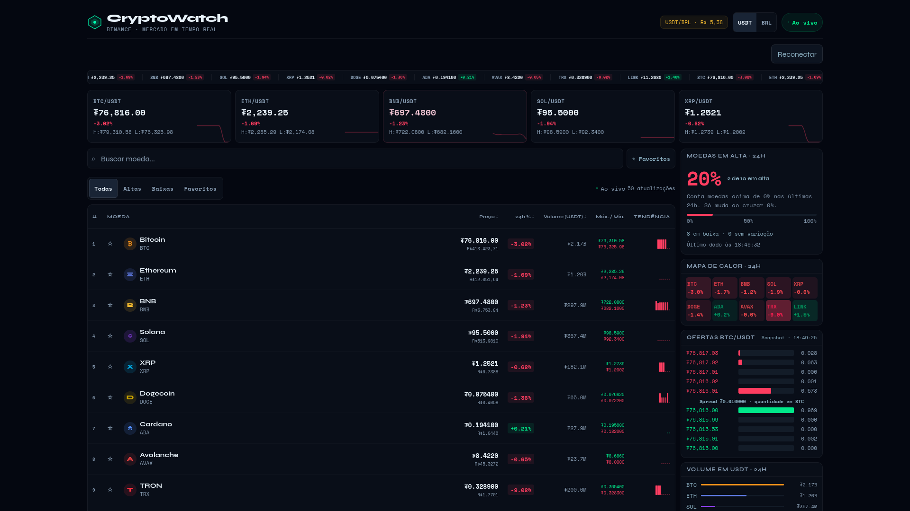

# CryptoWatch

Dashboard de criptomoedas feito com HTML, CSS e JavaScript, sem framework, backend ou etapa de build.

**Demo:** [michelfviana.github.io/crypto-watch](https://michelfviana.github.io/crypto-watch/)



> A imagem acima é da versão original. A publicação da demo depende do fluxo de deploy do repositório.

## Funcionalidades

- Cotações e estatísticas de 24 horas de dez moedas via WebSocket da Binance.
- Preços em USDT e conversão em BRL pelo par USDT/BRL.
- Busca, ordenação, filtros de altas/baixas e favoritos persistidos neste navegador.
- Minigráficos com as últimas 16 atualizações reais recebidas na sessão.
- Histórico de fechamentos em 1, 7 e 30 dias, com cache curto e cancelamento ao trocar o período.
- Livro de ofertas BTC/USDT com cinco níveis e snapshot atualizado a cada 15 segundos enquanto a página está visível.
- Mapa de calor, volumes e percentual de moedas acompanhadas com variação positiva.
- Conversor de quantidades, layout para celular e controles acessíveis por teclado.
- Reconexão progressiva, indicação de desconexão/dados parados, botão de reconexão e tratamento de falhas HTTP e limites da API.

Não há valores de mercado gerados aleatoriamente. O antigo Fear & Greed simulado foi substituído por **Moedas em alta**, calculado a partir das cotações acompanhadas. Esse indicador não é um índice de sentimento do mercado inteiro. Com as dez moedas recebidas, ele varia em passos de 10 pontos percentuais quando uma moeda cruza 0% na variação de 24 horas; preços podem mudar sem alterar o percentual. O card mostra o horário do último dado recebido e avisa quando perde a atualização ao vivo. As barras de tendência representam preços recebidos nesta sessão, não candles OHLC.

## Executar

Clone o repositório e sirva os arquivos com qualquer servidor estático:

```bash
git clone https://github.com/Michelfviana/crypto-watch.git
cd crypto-watch
python3 -m http.server 8080
```

Abra `http://localhost:8080`. Não é necessário instalar pacotes npm para usar o dashboard. A abertura direta de `index.html` também é possível em navegadores que permitem as conexões externas, mas um servidor local oferece um comportamento mais previsível para armazenamento e acesso à rede.

O Chart.js 4.4.1 está incluído em `vendor/`, com sua licença MIT. As fontes são carregadas pelo Google Fonts e têm fontes locais de fallback. Se os gráficos não puderem carregar, a tabela e os demais dados continuam disponíveis.

## Organização

| Arquivo | Responsabilidade |
| --- | --- |
| `index.html` | Estrutura, controles e diálogo de detalhes |
| `style.css` | Tema, responsividade e redução de movimentos |
| `api.js` | Acesso aos dados, timeout, validação e limites HTTP |
| `preferences.js` | Preferências locais com recuperação de falhas de armazenamento |
| `script.js` | Estado, conexão, renderização e interações |
| `tests/` | Testes de integração HTTP, validação e fluxos no Chromium |
| `docs/data-contract.md` | Fontes, contratos e limitações dos dados |

## Verificação

Com Node.js 22 ou superior:

```bash
npm run check
npm test
```

Para verificar os fluxos de interface, instale Chromium e execute:

```bash
npm run test:browser
```

Para outro executável compatível, use `CHROME_BIN=/caminho/do/chromium npm run test:browser`.

Os testes de navegador usam o código real do app e o Chart.js incluído, com um servidor HTTP local que representa a API e um WebSocket controlado. Verificam atualizações, rankings, foco, favoritos, moeda persistida, respostas atrasadas, Escape, falhas HTTP, reconexão e telas de 320/390 px. Não dependem da disponibilidade da Binance nem comprovam disponibilidade regional ou CORS da API real. As capturas de verificação ficam no diretório temporário do sistema.

## Dados e privacidade

- USDT não é USD. A conversão em reais usa o preço do par USDT/BRL na Binance, sem taxas ou spread de execução.
- Sem câmbio válido, os valores em BRL ficam indisponíveis. Um snapshot antigo do livro de ofertas é identificado como desatualizado quando a atualização falha.
- O estado da conexão só passa para “Ao vivo” depois de uma mensagem de mercado válida. Dados parados por mais de 20 segundos acionam a recuperação da conexão.
- Altas e baixas consideram apenas as dez moedas configuradas em `COINS`, não todo o mercado. Volume é o volume de negociação cotado em USDT.
- Favoritos e moeda são armazenados apenas no `localStorage`. Se o armazenamento estiver bloqueado, funcionam durante a sessão.
- Não utiliza chave de API, conta, banco de dados ou endpoints de negociação. O navegador se conecta diretamente à Binance, que recebe os dados usuais da conexão.
- Acesso à API depende de internet, disponibilidade do provedor e restrições regionais. Consulte [o contrato dos dados](docs/data-contract.md).

## Publicação

Publique `index.html`, `style.css`, `api.js`, `preferences.js`, `script.js` e `vendor/` juntos em um host estático, como o GitHub Pages. Não há build nem credenciais de produção.

Projeto educacional de acompanhamento de mercado.
